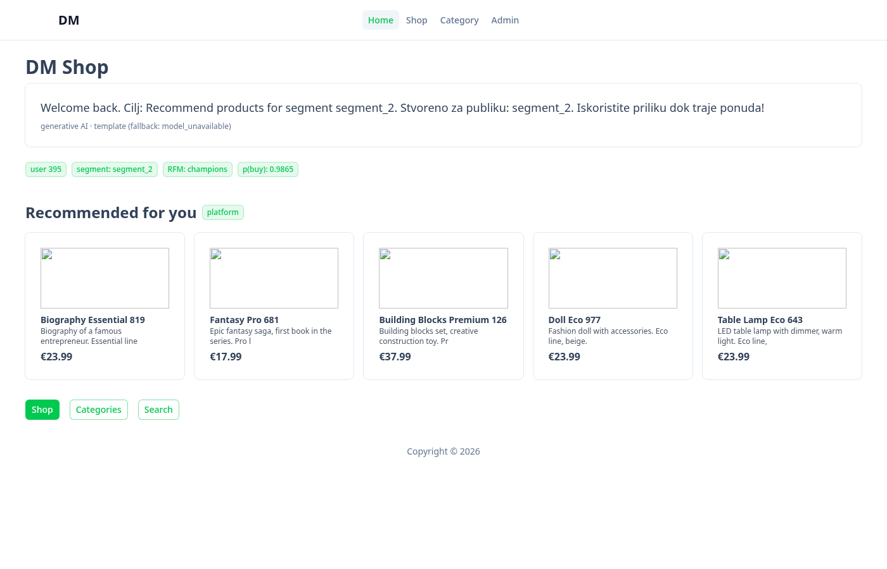
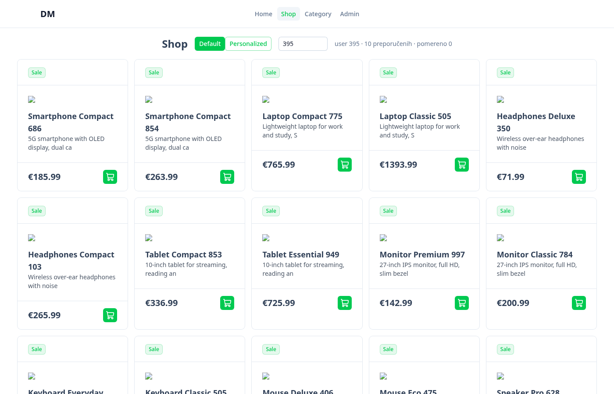
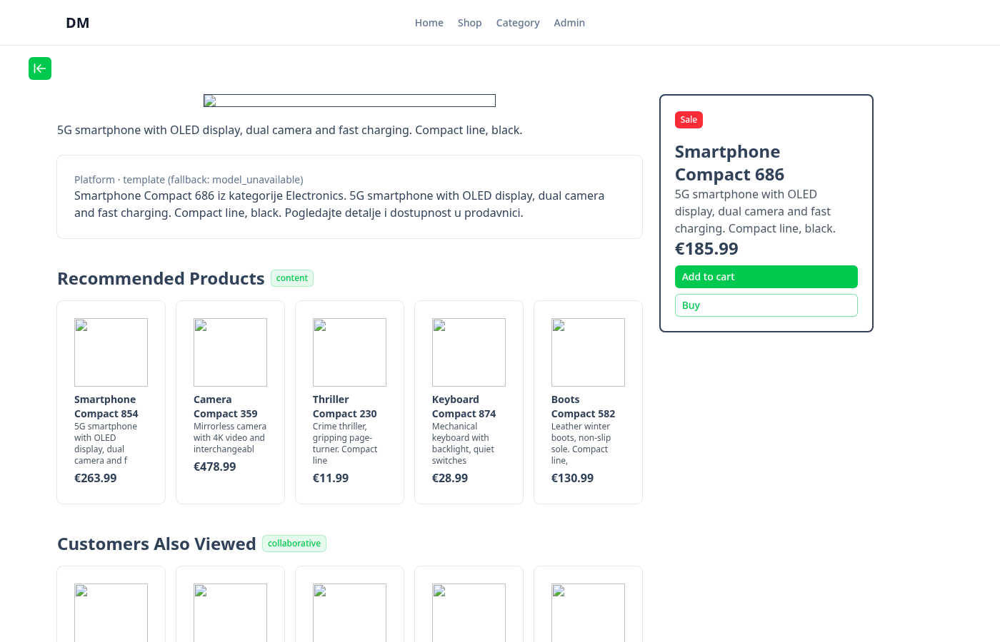
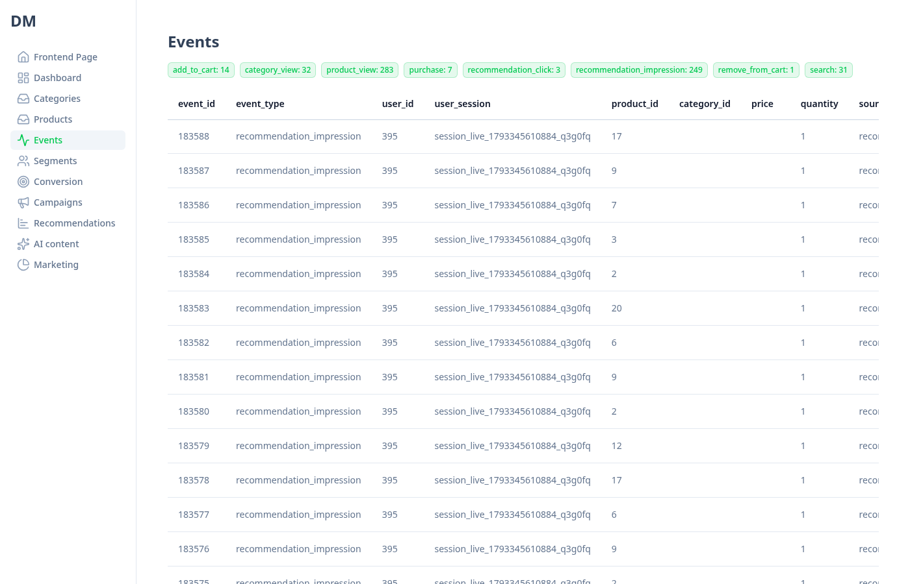

# dm-frontend — Nuxt prodavnica za kurs „Digitalni marketing i ML”

Frontend demo prodavnice iz kursa **Digitalni marketing i mašinsko učenje** (12 dana).
Ovo je *samo* Nuxt aplikacija — da studenti vide kako izgleda kod u praksi:
katalog, korpa, praćenje događaja (tracking) i admin panel koji prikazuje rezultate ML modela
(segmentacija, konverzija, kampanje, preporuke, AI sadržaj).

> Backend (dm-ml FastAPI), lekcije, beležnice i podaci su u monorepo-u:
> **https://github.com/TeodorPetrovic/dm-course-monorepo**



## Tehnologije

| Sloj | Alat |
|---|---|
| Framework | [Nuxt 4](https://nuxt.com) (Vue 3, file-based routing, Nitro server) |
| Runtime / paket menadžer | [Bun](https://bun.sh) (Nitro preset `bun`) |
| UI | [@nuxt/ui](https://ui.nuxt.com) 4, @nuxt/image, Tailwind (kroz Nuxt UI) |
| Baza | MariaDB / MySQL preko [Drizzle ORM](https://orm.drizzle.team) + `mysql2` |
| Validacija | zod |
| ML API | dm-ml (FastAPI, Python) — poseban servis na `:3001`, proksiran kroz `/ml/**` |

## Struktura

```
app/                      # sve što ide u browser (Vue)
  pages/                  # rute (file-based routing)
    index.vue             #   /                — početna sa marketing modulima (Dan 12)
    shop/index.vue        #   /shop            — katalog, personalizovan poredak „For you” (Dan 8)
    product/[slug].vue    #   /product/:slug   — detalj + preporuke: content (5), collaborative (6),
                          #                      session (9), semantic (10), AI opis (11/12)
    category/             #   /category, /category/:slug
    search.vue            #   /search?q=       — semantička pretraga (Dan 10)
    admin/                #   admin panel (layout admin.vue)
      event/              #     događaji iz baze (Dan 1 — event tracking)
      segments/           #     RFM / k-means segmenti (Dan 2)
      conversion/         #     predikcija konverzije (Dan 3)
      campaigns/          #     ciljanje kampanja, pravilo vs ML (Dan 4)
      recommendations/    #     evaluacija preporuka + CTR (Dani 7, 9), hybrid.vue (Dan 8)
      ai/                 #     generisanje SEO/opisa (Dan 11)
      marketing/          #     marketing moduli (Dan 12)
      product/, category/ #     klasičan CRUD nad bazom
  components/             # rec/Section.vue (kartice preporuka), MlUnavailable.vue, Delete dijalozi
  composables/
    trackEvent.ts         # trackEvent(): 8 tipova događaja → POST /api/event/track (Dan 1)
    useMl.ts              # mlGet/mlPost (greška → null, stranica se ne ruši), katalog, formatPrice
  layouts/                # default.vue (prodavnica), admin.vue (sidebar)
  types/                  # TS tipovi Product, Category
server/                   # Nitro (radi na serveru)
  api/                    # REST: /api/shop, /api/product/*, /api/category/*, /api/event/*
  database/
    connection.ts         # mysql2 pool + Drizzle (DB_* env)
    schemas/*.schema.ts   # Drizzle šeme: product, category, seo, event, user
  routes/ml/[...path].ts  # proxy /ml/** → dm-ml API (NUXT_ML_API_URL)
  utils/                  # dbHandler (503 kad baza ne radi), ml.ts (forward događaja), productWithSeo
db/                       # schema.sql + seed.sql (sintetički podaci: 12 kategorija, 252 proizvoda, 500 događaja)
docker-compose.yml        # lokalna MariaDB na 127.0.0.1:3307
scripts/smoke.py          # end-to-end test (Playwright)
docs/screenshots/         # slike za ovaj README
```

Komentari `// TEACH dNN: … // /TEACH` u kodu označavaju delove koji se pišu uživo na času
dana *NN* (vidi `teaching/` u monorepo-u). Na aplikaciju ne utiču.

## Pokretanje

Preduslovi: **Bun ≥ 1.2**, **Docker** (za bazu), opciono Python 3.11+ za dm-ml API.

```bash
cp .env.example .env          # po želji; podrazumevane vrednosti rade bez .env
docker compose up -d          # MariaDB sa šemom i seed podacima (127.0.0.1:3307)
bun install
bun run dev                   # http://localhost:3000
```

Produkcijski build: `bun run build && bun .output/server/index.mjs`.

### Promenljive okruženja

| Promenljiva | Podrazumevano | Opis |
|---|---|---|
| `NUXT_ML_API_URL` | `http://127.0.0.1:3001` | bazni URL dm-ml API-ja (runtime, bez rebuild-a) |
| `DB_HOST` / `DB_PORT` | `127.0.0.1` / `3307` | lokalna MariaDB |
| `DB_NAME` / `DB_USER` / `DB_PASSWORD` | `dm_local` | lažni lokalni demo kredencijali — nikad prava baza |
| `PORT` | `3000` | port produkcijskog servera |

### Baza podataka

`docker compose up -d` pri prvom pokretanju učitava `db/schema.sql` i `db/seed.sql`.
Reset na početno stanje: `docker compose down -v && docker compose up -d`.
Bez Dockera: napravi bazu i korisnika `dm_local` u bilo kojoj lokalnoj MariaDB/MySQL 8 i
`mysql -udm_local -p dm_local < db/schema.sql && mysql -udm_local -p dm_local < db/seed.sql`, pa podesi `DB_*`.

Ako baza nije pokrenuta, `/api/*` vraća **503 „Database unavailable”** sa uputstvom umesto pada servera.

## Kako frontend priča sa dm-ml API-jem

```
Browser ──/ml/segments──▶ Nuxt (server/routes/ml/[...path].ts) ──▶ dm-ml :3001/segments
Browser ──POST /api/event/track──▶ Nuxt ──▶ upis u MariaDB (event) ──▶ forward na dm-ml /events (best-effort)
```

* Sve ML stranice zovu `/ml/...` (isti origin, bez CORS-a); server ih prosleđuje na `NUXT_ML_API_URL`.
* Ako dm-ml ne radi, proxy vraća **502**; `useMl()` vraća `null` i stranice prikazuju podrazumevani
  sadržaj ili poruku „dm-ml nije dostupan” — prodavnica i tracking rade i dalje.
* dm-ml pokrećeš iz monorepo-a:
  ```bash
  git clone https://github.com/TeodorPetrovic/dm-course-monorepo && cd dm-course-monorepo
  scripts/setup.sh && cd apps/api && .venv/bin/uvicorn app.main:app --port 3001
  ```
* Demo korisnik je `user_id = 395` (`DEMO_USER_ID` u `trackEvent.ts`), sesija se čuva u `localStorage`.

## Test

```bash
bun run build
DM_ML_DIR=../dm-course-monorepo/apps/api $DM_ML_DIR/.venv/bin/python scripts/smoke.py   # 42 provere
```

## Slike

| Prodavnica | Proizvod + preporuke | Admin: događaji |
|---|---|---|
|  |  |  |

Slike proizvoda nisu deo repoa (seed sadrži samo putanje), pa se prikazuju prazni okviri.

## Licenca

[MIT](LICENSE) © 2026 Teodor Petrović
